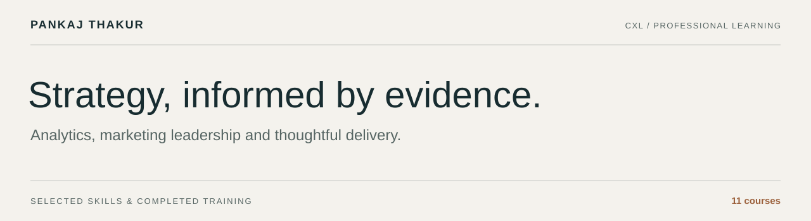
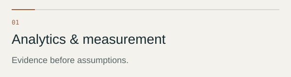
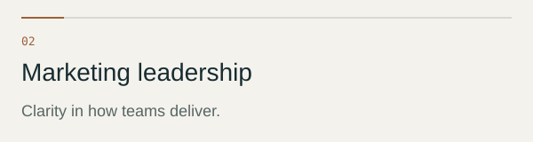
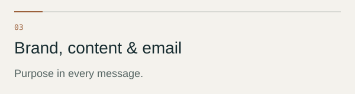
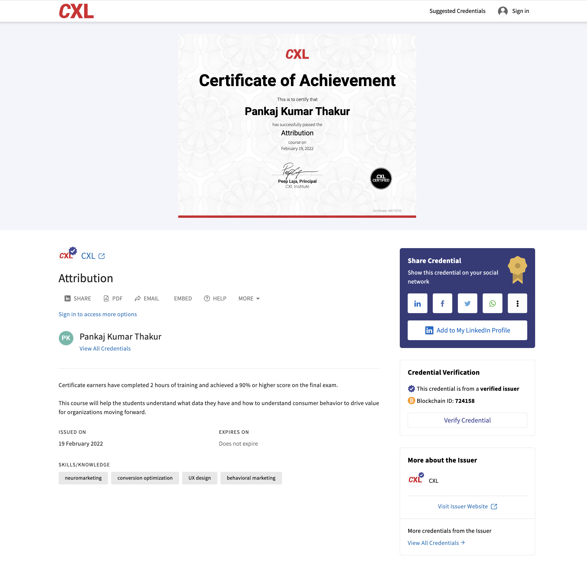
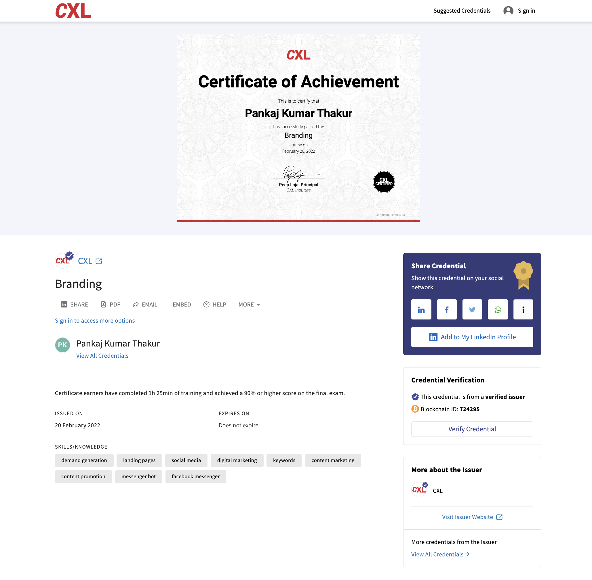

# Analytics, strategy & marketing leadership

**Pankaj Thakur · Skills portfolio · CXL course certificates**

I help turn marketing questions into clear plans, useful measurement and organised delivery. My focus connects customer behaviour, content, team operations and the commercial side of marketing services.

This portfolio brings together 11 completed CXL courses, organised around the skills they support. Each certificate is available to inspect alongside a concise summary of its subject.

[Explore skills](#skills-at-a-glance) · [How I work](#how-i-work) · [Where I can help](#where-i-can-help) · [Browse certificates](#certificate-library) · [View previews](#certificate-previews) · [Connect on LinkedIn](https://www.linkedin.com/in/pankajvnt/)

---

## Skills at a glance

<table>
<tr>
<td width="50%" valign="top">

Understanding customer behaviour, choosing product metrics, reading reports and organising tracking. Connecting measurement to the decisions a marketing team needs to make.

**Learning:**Attribution · Google Analytics · Google Tag Manager · Product analytics

</td>
<td width="50%" valign="top">

Setting objectives, planning work, managing budgets and helping teams stay focused. Turning a marketing goal into a process with clear responsibilities and measurable outcomes.

**Learning:**Marketing management · Project Management for Marketers

</td>
</tr>
<tr>
<td width="50%" valign="top">

Bringing branding principles into communication, building search-led editorial plans and improving email programmes through content and analysis.

**Learning:**Branding · Email marketing · SEO driven editorial calendar

</td>
<td width="50%" valign="top">

Shaping service offers, pricing work, managing client relationships and organising delivery. Understanding the commercial and operational side of conversion optimisation services.

**Learning:**Building a marketing agency · CRO agency masterclass

</td>
</tr>
</table>

## How I work

**Understand the question.** Clarify the audience, the business problem and the evidence already available.

**Plan the work.** Agree the goal, the measure, the responsibilities and the order of delivery.

**Deliver with focus.** Build the report, editorial plan, email programme or delivery process around that goal.

**Review and improve.** Use results and feedback to decide what deserves attention next.

---

## Where I can help

These are areas I can contribute to, grounded in the learning documented below.

| Area of support | What the work can include |
| --- | --- |
| **Marketing measurement**| A measurement brief, reporting questions, tracking requirements and a review of attribution assumptions. |
| **Team and project delivery**| Objectives, responsibilities, a campaign plan and a practical review cadence. |
| **Content and email planning**| An editorial calendar, email improvement priorities and measures for evaluating performance. |
| **Agency and CRO service design**| Offer structure, project scope, pricing considerations and a client kickoff plan. |

### How the skills connect

| Practical focus | What I bring to the work |
| --- | --- |
| Make measurement useful | Start with a business question and identify the data needed to answer it. |
| Understand product behaviour | Define meaningful metrics and compare user segments to find areas for investigation. |
| Organise marketing delivery | Connect objectives, budgets, responsibilities and project plans. |
| Plan content with purpose | Translate search priorities into a usable editorial calendar. |
| Improve email performance | Review list growth, content and results to guide improvements. |
| Structure service engagements | Clarify the offer, price, kickoff process and expectations for delivery. |

---

## Certificate library

The titles below link to the original images. Summaries describe the course subjects rather than results from client work.

| Completed course | Subject focus |
| --- | --- |
| [Attribution](./Attribution.png) | Understanding marketing data and customer behaviour to inform decisions |
| [Google Analytics for beginners](./Google%20Analytics%20for%20beginners.png) | Analytics foundations, reports, goals, segmentation and data analysis |
| [Google Tag Manager for beginners](./Google%20Tag%20Manager%20for%20beginners.png) | Tracking-script deployment, tag organisation and measurement foundations |
| [Product analytics](./Product%20analytics.png) | Product metrics, user segments, spreadsheet analysis and basic MySQL queries |
| [Marketing management](./Marketing%20management.png) | Objectives, project planning, budgets, conflict resolution and team onboarding |
| [Project Management for Marketers](./Project%20Management%20for%20Marketers.png) | Campaign processes, team focus, clear goals and measurable delivery |
| [Branding](./Branding.png) | Branding principles |
| [Email marketing](./Email%20marketing.png) | List growth, email content, performance analysis and return on email investment |
| [SEO driven editorial calendar](./SEO%20driven%20editorial%20calendar.png) | Building a practical editorial calendar around search and content priorities |
| [Building a marketing agency](./Building%20a%20marketing%20agency.png) | Principles of agency growth and scaling a service business |
| [CRO agency masterclass](./CRO%20agency%20masterclass.png) | CRO service positioning, pricing, productised offers and client-project delivery |

The stored records state that these credentials do not expire. Course titles are retained as awarded; the beginner analytics courses are not presented as GA4 certification or evidence of current platform-specific training.

## Certificate previews

Expand a category to browse its original records. Click any image to open the full-size version.

<strong>Analytics & measurement · 4 certificates</strong>

### Attribution

### Google Analytics for beginners

### Google Tag Manager for beginners

### Product analytics

<strong>Marketing leadership & delivery · 2 certificates</strong>

### Marketing management

### Project Management for Marketers

<strong>Brand, content & email · 3 certificates</strong>

### Branding

### Email marketing

### SEO driven editorial calendar

<strong>Agency & CRO service delivery · 2 certificates</strong>

### Building a marketing agency

### CRO agency masterclass

---

### Let's talk about the work

For conversations about marketing strategy, analytics, team operations or service delivery, [connect with me on LinkedIn](https://www.linkedin.com/in/pankajvnt/).

Personal skills and learning portfolio. CXL is the training provider; this repository does not imply employment, partnership or endorsement.
